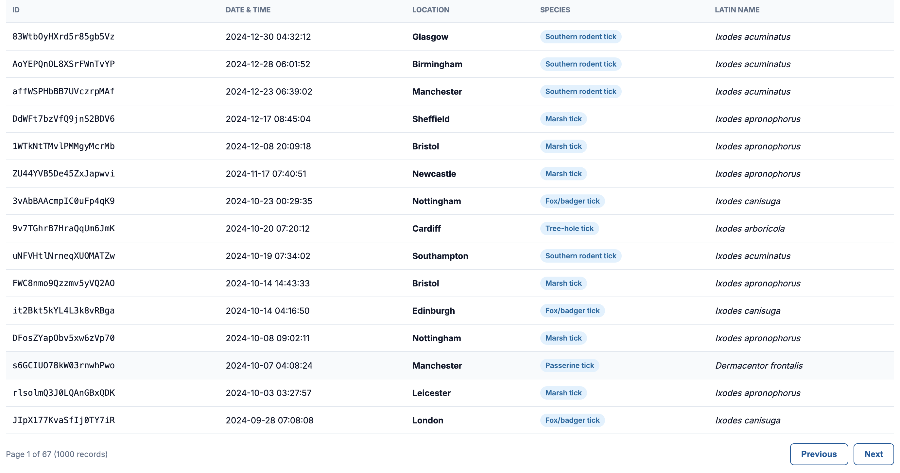

# Elanco Tick Sighting Tracker — Backend MVP

This project is built using **Python** and **Django** with a **Model-View-Controller (MVC)** architecture. It also includes unit tests to verify the application’s functionality and ensure its components work as expected.

# Project Choices

| Component       | Choice                                           | Rationale                                                                                                               |
| :-------------- | :----------------------------------------------- | :---------------------------------------------------------------------------------------------------------------------- |
| **Language**    | **Python 3.14+**                                 | Simple Language and what I'm familiar with                                                                              |
| **Framework**   | **Django 6+**                                    | Industry standard web framework offering a Model-View-Controller architecture and improved unit tests                   |
| **Data Model**  | `TickSighting` model (`sightings/models.py`)     | Core model with primary key deduplication, field validation, and database indexes on `location`, `date`, and `species`. |
| **Database**    | **SQLite (`db.sqlite3`)**                        | Zero-configuration                                                                                                      |
| **HTTP Client** | **`requests`**                                   | Reliable HTTP client with timeout management and status handling.                                                       |
| **Testing**     | **Django Test Framework (`TestCase`, `Client`)** | Comprehensive test coverage across models, services, filters, reports, and HTTP responses.                              |

# Video

[](presentation.mp4)

# How to Run the Project

### 1. Clone the project

```
git clone https://github.com/M0-7/Sightings.git
cd Sightings
```

### 2. Create and activate a virtual environment

```
python3 -m venv .venv
source .venv/bin/activate
```

### 3. Install dependencies

```
pip install -r requirements.txt
```

### 4. Make migrations

```
python3 manage.py makemigrations
python3 manage.py migrate
```

### 5. Run the Django server

```
python manage.py runserver
```

# Author Information

**Candidate:** Moaz Haider

**Date:** November 2026

**Company:** Elanco Animal Health
